# Assignment Helper

A web app that helps university students get assignments done on time: clarify what the task really asks, turn it into a solid AI prompt, split the work into daily tasks before the deadline, find real academic papers, and draft the write-up one approved section at a time.[demo mode](#try-the-demo-2-minutes) 

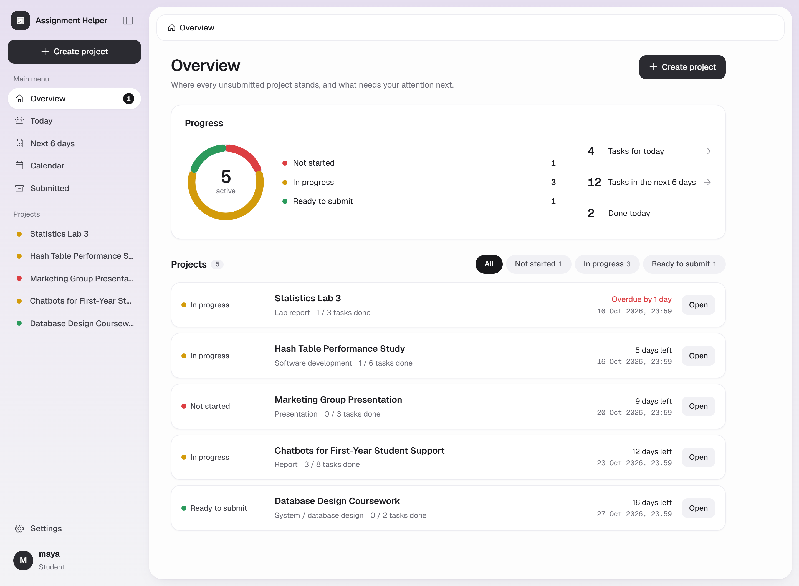

## Why I built it

Students rarely fail an assignment because they can't write. They fail because they misread the brief, start too late, or cite sources they never checked. General AI chats make this worse: they happily guess the requirements, invent references, and produce one big answer with no plan behind it.

I wanted a tool that does the opposite, and I wanted to learn how to put an LLM inside a real backend properly: accounts, a database, server-side AI calls, structured output that is validated in code, and failures that degrade gracefully.

- **Requirements first.** Nothing downstream is generated until the gaps in the brief have been asked about or explicitly marked as assumptions.
- **The AI proposes, the code decides.** Dates, citations, quotes from the guideline and paper IDs are all checked in code. The model can't invent a deadline, a rule or a reference.
- **The student stays in charge.** Every AI result is a draft to review, edit and approve.

## Try the demo (2 minutes)

Demo mode needs no API keys and makes no outside calls: the AI and the paper search answer from built-in samples, and sign-up, Google sign-in, email and push are switched off.

```bash
git clone https://github.com/LimFangXuan/AI-based-assignment-helper-Active-Development.git
cd AI-based-assignment-helper-Active-Development
python -m venv venv
venv\Scripts\activate            # macOS/Linux: source venv/bin/activate
pip install -r requirements.txt
set DEMO_MODE=1                  # macOS/Linux: export DEMO_MODE=1   (PowerShell: $env:DEMO_MODE="1")
set SECRET_KEY=any-long-random-string
python run.py                    # open http://127.0.0.1:5000 and press "Enter the demo"
```

What you get:

- A one-click demo account with six fictional projects. One of them has already been through all five tools, so every screen has something to show.
- A banner on every page, and a **Reset demo data** button that puts everything back to the original sample (it also resets on every restart).
- All five tools still work on new projects, with offline sample answers in place of Gemini and fictional papers (example `10.5555` DOIs) in place of OpenAlex.
- Settings is read-only apart from the theme and **Download my data**.

Please don't type personal information into the demo. It runs on your own machine, but it is meant for sample data only.

## Screenshots

| | |
|---|---|
| 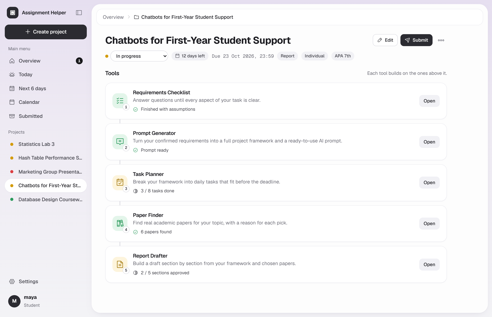 | 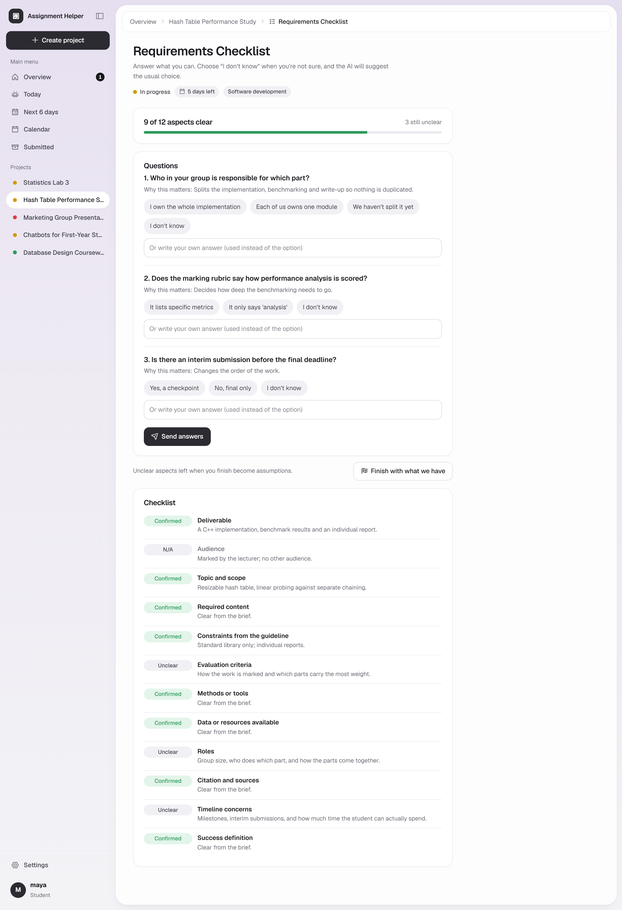 |
| **Project page**: the five tools in dependency order, each showing its state. | **Requirements Checklist**: questions only about real gaps in the brief. |
| 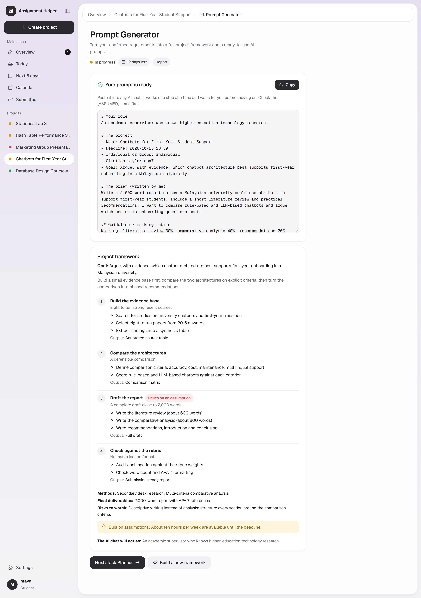 | 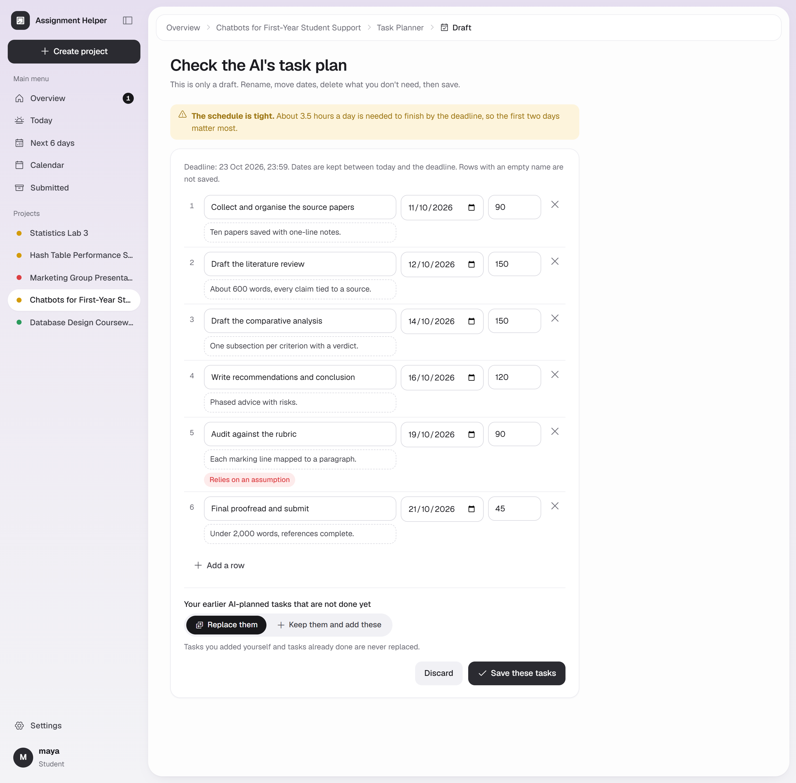 |
| **Prompt Generator**: a confirmed framework and a code-assembled prompt. | **Task Planner**: a day-by-day draft to review before anything is saved. |
| 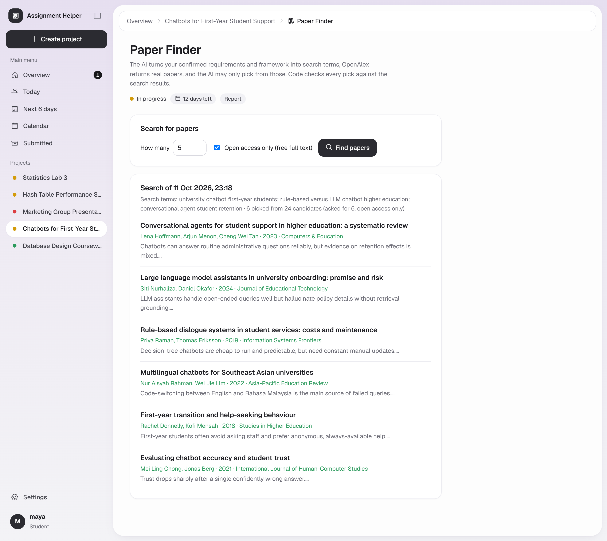 | 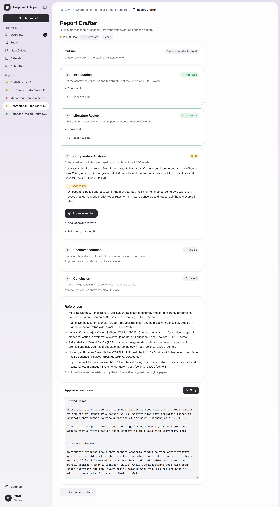 |
| **Paper Finder**: picks come only from papers that were really retrieved. | **Report Drafter**: one section at a time, citations checked in code. |
| 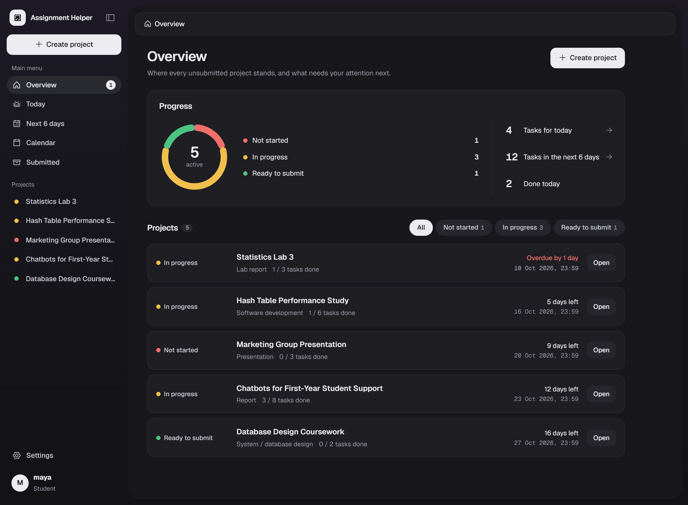 | 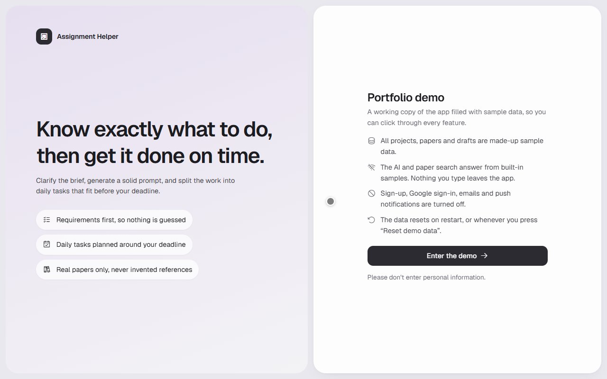 |
| **Dark theme**. | **Demo mode** sign-in page. |

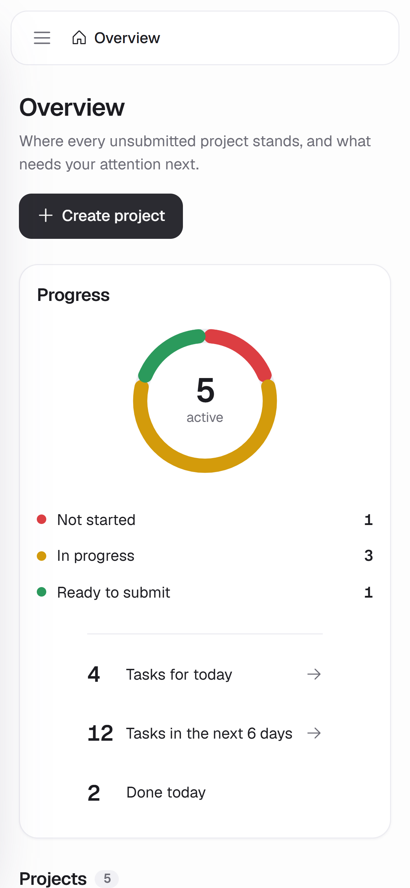

## The workflow

Each project has five tools. The order is the dependency chain: every tool reads the confirmed output of the ones before it.

| # | Tool | What it does |
|---|---|---|
| 1 | Requirements Checklist | Pre-scans the description and guideline, marks 12 aspects (deliverable, audience, scope, marking, constraints...) as clear / unclear / not applicable, then asks up to 3 questions per round about the real gaps only. Conflicts with the guideline are flagged with the exact words they come from. "Finish with what we have" turns what is left into labelled assumptions. |
| 2 | Prompt Generator | Builds a project framework (phases, methods, deliverables) from the confirmed requirements. Genuine forks show up as "Needs your decision" on the same page. Once confirmed, the code assembles a copy-paste prompt that makes any AI chat work one step at a time and wait for you. |
| 3 | Task Planner | Turns the framework into day-by-day tasks before the deadline, says honestly when time is too short, and lets you edit, tick, reorder or add your own tasks. |
| 4 | Paper Finder | Searches OpenAlex with terms derived from the requirements and framework; the AI may only pick from what was retrieved. |
| 5 | Report Drafter | Writes the outline (guideline structure first, then the FYP or Report template), then one section at a time: read, edit, add ideas and rewrite, approve. The next section unlocks only after approval. Paragraphs cite only Paper Finder results; anything without a source is flagged. |

Later tools never lock: they show a hint when an earlier step is missing. Anything that relies on an assumed requirement is labelled all the way down (framework phases, tasks, report paragraphs).

Paper Finder and Report Drafter are hidden for *Portfolio* and *Exam preparation* projects. The type is chosen by the student, not guessed by the AI.

## Tech stack

| Layer | Choice | Why |
|---|---|---|
| Backend | Python 3, Flask 3 (app factory + blueprints) | Small enough to understand completely; easy to test with the built-in test client. |
| Database | SQLite via Flask-SQLAlchemy | Zero setup for a single-machine app. `ensure_schema()` upgrades old databases in place without losing data. |
| AI | Google Gemini (`google-genai`), primary + fallback model | Structured JSON output, validated in code. Model names live in `.env`. |
| Papers | OpenAlex REST API (`httpx`) | Free, open scholarly metadata with real DOIs. |
| Front end | Jinja templates, hand-written CSS (light + dark tokens), vanilla JS | No build step. Every action is a plain form POST that JS upgrades to an in-place update. |
| Auth & mail | Salted password hashes, Google OAuth (code + PKCE), SMTP, Web Push (VAPID, `pywebpush`) | All optional. Each one explains itself when it isn't configured. |
| Tests | One script, `test_app.py`: 504 checks | AI, OpenAlex, Google, SMTP and push are all faked, so the tests never touch the network. |

## Architecture

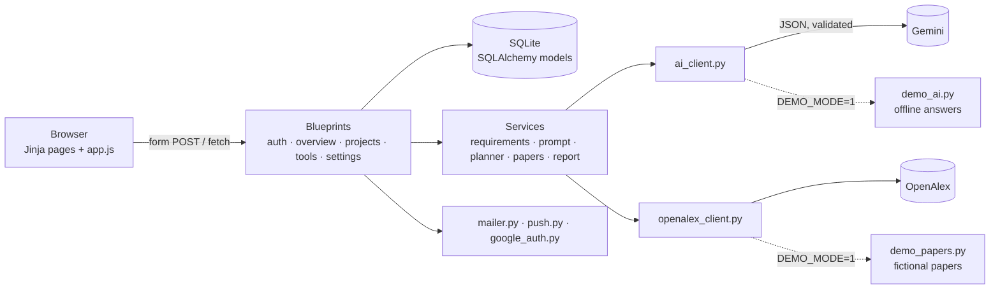

Each outside service has exactly one module that talks to it (`ai_client`, `openalex_client`, `google_auth`, `mailer`, `push`). That makes it easy to fake in tests and to switch off in demo mode. The services layer never imports Flask request objects or models, so the logic can be tested without a browser.

```
run.py                     entry point (python run.py, or a WSGI server pointed at run:app)
app/
  __init__.py              create_app(): config, extensions, blueprints, CSRF hook, ensure_schema()
  extensions.py            db = SQLAlchemy()
  security.py              login_required, CSRF, ownership checks, safe redirects
  validators.py            username / password / email rules shared by sign-up, Settings and Google sign-up
  login_throttle.py        in-memory limit on repeated failed logins and password checks
  data_export.py           builds the "Download my data" file
  tokens.py                signed one-time links for email confirmation and password reset (no extra table)
  emails.py                the text and HTML of every email
  account_mail.py          sends confirmation, reset and security emails
  reminders.py             daily summary and deadline reminders, per user time zone, never sent twice
  urls.py                  full links for emails and push (APP_BASE_URL)
  demo_data.py             the fictional sample data (seed_demo.py and demo mode share it)
  constants.py             statuses, types, length limits, thresholds (one place to tune)
  tools_registry.py        the five tools, their order and visibility
  schema.py                ensure_schema(): new tables, missing columns, indexes
  template_helpers.py      template filters and sidebar data (one query)
  models/                  user, project, requirements, prompt, plan (tasks), paper, report
  blueprints/              auth, overview (/, /today, /upcoming), calendar, projects, settings, cron, demo, tools/*
  services/                no Flask request objects and no imports from models
    ai_client.py           the only module that talks to Gemini
    openalex_client.py     the only module that talks to OpenAlex
    privacy.py             masks emails and phone numbers before text reaches the AI
    google_auth.py         the only module that talks to Google OAuth (authorization code + PKCE)
    mailer.py              the only module that sends email (any SMTP service, or a console mode for development)
    push.py                the only module that sends Web Push (VAPID keys, encryption via pywebpush)
    common.py              shared helpers: project block (data, not instructions), input-size check, quote check
    requirements_checker.py  Requirements Checklist: pre-scan, rounds, validation, context for later tools
    prompt_generator.py    framework generation and code-assembled final prompt
    task_planner.py        day-by-day plan, date clamping, time feasibility
    paper_finder.py        search terms and candidate selection
    report_drafter.py      outline, section drafts, citation markers, export
    citations.py           in-text citations and reference lists from metadata (APA 7, Harvard, IEEE, MLA, Chicago)
    demo_mode.py           DEMO_MODE=1 switch
    demo_ai.py             offline stand-in for Gemini in demo mode (answers each task type from the prompt)
    demo_papers.py         offline stand-in for OpenAlex in demo mode (fictional papers, 10.5555 example DOIs)
  skills/                  plain data files: rules, question banks, best practices, the 12 requirement aspects,
                           report templates (FYP, Report)
  templates/               layout.html, components/, pages/
  static/                  style.css (design tokens, light + dark), app.js
test_app.py                automated tests (AI, OpenAlex, Google, SMTP and push are all mocked)
seed_demo.py               local demo account with sample data (demo / demo1234)
send_reminders.py          run this on a schedule (hourly) to send reminders
generate_vapid_keys.py     prints a VAPID key pair for push
check_models.py            checks which Gemini models currently work
```

## Features

- **Accounts**: register / login / logout with salted password hashes, or **Continue with Google** (sign in or sign up). Failed logins are rate-limited per username and address. **Forgot password** emails a one-time reset link (1 hour), and password or email changes send a security notice.
- **Email and push notifications**: confirm your email, then choose a **daily summary** (today's tasks, overdue tasks, deadlines today, at the hour you pick in your own time zone) and **deadline reminders** (3 days and 1 day before), each by email, push, or both. Push works per device (Chrome, Edge, Firefox, Android; Safari and iPhone once the site is added to the Home Screen). Nothing is on until you turn it on.
- **Settings**: change username and optional email (confirmed by link); change password (or set one if you signed up with Google); connect or disconnect Google; notification settings and devices; light / dark theme; a plain-language **Privacy & data** section; **Download my data** (JSON); **Delete account** (removes everything).
- **Projects**: name, deadline, description (the task itself), guideline / marking rubric, type, individual or group, citation style. Live character counters.
- **Overview**: a status ring (Not started / In progress / Ready to submit) with counts, today's and the next six days' task counts, then one card per project with a status filter.
- **Today** and **Next 6 days**: tasks across all projects, grouped by day, ticked off in place.
- **Calendar**: month grid of deadlines with a month strip, `+N more` for busy days, today marked.
- **Sidebar**: create button, main menu, the 8 nearest projects with status dots, and an Overview badge for projects that are overdue or due within 3 days. Collapsible (remembered per browser); a drawer on phones.
- **Tasks**: add (press Enter to keep adding), inline edit, tick, delete, drag to reorder. The project status follows: the first tick sets *In progress*, the last one *Ready to submit*.
- **Submit / delete**: submitting is a soft delete (status `submitted`, data kept, can be moved back). Delete permanently removes a project after a confirmation dialog.
- **Stale detection**: requirements checks, frameworks, planned tasks and report drafts store a fingerprint of the description + guideline; if either changes later, the tool says "Details changed since this was created. Update?". Nothing is re-run automatically (that would spend AI quota).
- **Light and dark themes**, chosen in Settings.

## Design decisions

- **The skill lives in the repo, not in a vendor.** The method was first written as a Claude Agent Skill. Its rules, question banks and best practices were ported into `app/skills/prompt_generator/` and loaded by code, so the same knowledge works with any model.
- **The AI can only recommend papers that were actually retrieved.** Picks are validated in code: IDs are normalised, anything not in the candidate set is dropped and logged, duplicates are removed, and nothing is stored unless the whole pipeline succeeds. This is a fixed pipeline, not tool use: code decides when to search; the model only proposes search terms and chooses among results.
- **Requirements before anything else.** Every later tool reads the confirmed requirements, so nothing important is guessed. The checker is capped internally (3 questions per round, 5 rounds, at most 6 AI calls) and the student can stop at any time.
- **Evidence is checked in code.** A conflict the AI reports must quote the student's material, and the code verifies the quote really appears there; otherwise it is dropped. This stops the AI from inventing guideline rules.
- **The generated prompt asks the other AI to work step by step** (one step at a time, waiting for the student's confirmation) rather than restricting it to guidance only. Its safety parts are not left to the model: confirmed facts, recommendations and assumptions are always separated, the rule against inventing sources or facts is always present, and no prompt is built while a conflict is unresolved.
- **Dates are never trusted from the AI.** Task Planner drafts are clamped to today…deadline, nonsense durations are dropped, the code computes hours per day itself to flag a schedule that can't fit, and nothing is saved until the student reviews the draft.
- **Citations can't be invented.** The Report Drafter cites with markers like `[P12]`; code removes any marker that is not one of this project's papers, and builds in-text citations and the reference list from OpenAlex metadata. Paragraphs without a valid source are flagged "needs source".
- **Privacy.** Emails and phone numbers are masked in the description and the guideline before anything reaches the model; the database keeps the original text. Other personal details cannot be detected reliably, and the form warns about them.
- **Prompt-injection hygiene.** Description, guideline and retrieved abstracts are wrapped in delimiters and declared as data, not instructions.
- **AI output is validated, not trusted.** JSON is parsed and schema-checked; invalid output gives a retry message and never leaves a half-written record.
- **Graceful degradation.** Every AI request has a timeout; 5xx errors are retried; an overloaded, slow, out-of-quota or missing primary model falls back to a second model. Errors a different model can't fix (bad key, bad request) don't trigger a fallback. Users see a plain message; the real error goes to the log.
- **Works without JavaScript.** Every action is a normal form POST; `app.js` upgrades it to an in-place update (requests carry `X-Requested-With: fetch` and get JSON back). The `next` redirect target is restricted to same-site paths.
- **Motion has a job.** Animations mark a state change (tick, progress, new row, dialog, AI waiting) and are switched off under `prefers-reduced-motion`. Status is always shown as text too, never by colour alone.
- **Google sign-in is hard to abuse.** Authorization code flow with a random `state` (checked in constant time, single use) and PKCE; the client secret never reaches the browser; accounts are matched by Google's stable ID, not the email; only Google-verified emails are accepted. A Google email that matches an existing password account is **not** merged automatically (emails entered here are unverified, so merging would let someone take over an account by registering with its email): the user logs in and connects Google from Settings instead.
- **Email links can't be abused.** Confirmation links are bound to the exact address and expire after 3 days; reset links expire after an hour and are bound to the current password, so the first use (or any password change) kills them. "Forgot password" gives the same answer whether or not the address exists, and requests are rate-limited so it can't be used to spam someone. An email typed in by one user but never confirmed doesn't block the person who really owns that address.
- **Reminders are idempotent.** Every sent reminder is recorded (user, kind, project and deadline), so running the job twice, or late, never repeats one; a failed send isn't recorded and is retried on the next run. Dead push subscriptions (HTTP 404/410) are deleted automatically.
- **Security basics.** Hashed passwords, per-session CSRF tokens on every POST, ownership checks on every project and child record (other users get 404), identical error for unknown user vs wrong password, Jinja auto-escaping.
- **Schema upgrades without data loss.** `ensure_schema()` runs inside `create_app()`, so any start-up path works on a fresh database. Missing columns are added with `ALTER TABLE ... ADD COLUMN`; columns and tables are never dropped. Old projects get `type = other`, `individual` and an empty guideline.

## Running the full app (with real AI)

The full app needs your own API keys. Calls to Gemini and OpenAlex send the project text (with emails and phone numbers masked) to those services, and free-tier Gemini inputs may be used by Google to improve its models. For showing the project to someone, [demo mode](#try-the-demo-2-minutes) is the safer choice.

Optional, for **Continue with Google**: in Google Cloud Console create an OAuth client ID (type *Web application*), add `http://127.0.0.1:5000/auth/google/callback` as an authorised redirect URI (plus your public URL when deployed), and put the client ID and secret in `.env` as `GOOGLE_CLIENT_ID` and `GOOGLE_CLIENT_SECRET`. Open the app on the same host you registered (`127.0.0.1` and `localhost` are different to Google). Without these the button explains that Google sign-in isn't set up.

```bash
python -m venv venv
venv\Scripts\activate          # macOS/Linux: source venv/bin/activate
pip install -r requirements.txt
cp .env.example .env           # then fill in SECRET_KEY, GEMINI_API_KEY, OPENALEX_API_KEY
python run.py                  # http://127.0.0.1:5000
python seed_demo.py            # optional: sample data, log in as demo / demo1234
```

Generate a `SECRET_KEY` with `python -c "import secrets; print(secrets.token_hex(32))"`. Get a Gemini key at https://aistudio.google.com and a free OpenAlex key at https://openalex.org/settings/api. Free-tier Gemini inputs may be used by Google to improve its models, so don't paste sensitive material.

Set `FLASK_DEBUG=1` in `.env` for auto-reload and error pages while developing. Never enable it on a public server: the Werkzeug debugger can run code.

## Optional services checklist

Everything below is optional: without it the app still runs, and each feature explains what's missing.

1. **Google sign-in**: create an OAuth client in Google Cloud Console, add the redirect URI, put `GOOGLE_CLIENT_ID` and `GOOGLE_CLIENT_SECRET` in `.env` (see above).
2. **Email**: pick an SMTP service (for Gmail: turn on 2-step verification, create an *App password*), fill `SMTP_HOST`, `SMTP_PORT`, `SMTP_USERNAME`, `SMTP_PASSWORD`, `MAIL_FROM` in `.env`, restart, then use *Settings > Notifications > Send a test email*. Until then emails are printed in the server log.
3. **Push**: nothing to do on a laptop (keys are generated into `instance/vapid.json`). For a real deployment run `python generate_vapid_keys.py`, put both lines in the host's environment variables, and serve the site over **https** (browsers only allow push on https or localhost).
4. **Reminders need a schedule**: something must run `python send_reminders.py` every hour.
   - Windows (Task Scheduler): `schtasks /Create /SC HOURLY /TN AssignmentHelperReminders /TR "cmd /c cd /d C:\path\to\assignment-helper && venv\Scripts\python.exe send_reminders.py"`
   - Linux / macOS (cron): `0 * * * * cd /path/to/assignment-helper && venv/bin/python send_reminders.py`
   - Hosts without cron: set `REMINDER_TOKEN` and have the host's scheduler call `POST /cron/reminders` with the header `Authorization: Bearer <token>`.
5. **Deployment**: set `APP_BASE_URL` (the public https address) so links in emails and notifications are right, and keep `FLASK_DEBUG` off.
6. **Try it on your own devices**: confirm your email, turn on push in your browser, set your time zone, and send yourself a test email and a test push. On an iPhone, add the site to the Home Screen first.

## Tests

```bash
python test_app.py
```

504 checks. Nothing touches the network: the AI is replaced by a fake that answers by task type, and OpenAlex, Google, SMTP and Web Push are faked with `httpx.MockTransport` and stub objects. They cover:

- **Demo mode**: closed pages, blocked account changes, one-click entry, reset, all five tools working offline, and no network connections at all.
- **The five tools**: requirement rounds and conflict evidence, framework decisions, the code-built prompt, date clamping in the planner, invented paper IDs dropped, invented citations removed.
- **Failure handling**: simulated 503/429/403/timeout/network failures and model fallback, including a real SDK call against a deliberately slow local server.
- **Accounts and security**: auth and CSRF, per-user isolation on every route, login throttling, the Google flow (PKCE, state, replay, no automatic merge), email confirmation and reset links (expiry, tampering, single use, no account enumeration).
- **Notifications**: the SMTP and console mailer, push encryption and VAPID signatures checked by a simulated browser, and the reminder engine (time zones, once per day, retries, dead devices removed).
- **Data**: export, account deletion, starting on a fresh database, and upgrading an old database without losing data.

## Honest limitations

- **Not deployed.** It runs on one machine with SQLite. A public version would need a production WSGI server, HTTPS, a real database, a scheduler for reminders, and a privacy policy.
- **AI calls are synchronous.** A long Gemini call holds a request thread. A real deployment would move them to a background queue.
- **Demo mode answers are canned.** They follow the real data shapes and react to your input, but they are not real AI output. Run the full app to see Gemini.
- **Login throttling is in memory**, so it resets on restart and isn't shared between processes.
- **The AI writes in English only.** Harvard, MLA and Chicago reference entries use a simplified format.
- Reminders are only as punctual as the scheduled job (hourly is recommended). If two copies run at the same moment, a reminder could in rare cases be sent twice.
- Push on iPhone only works once the site is added to the Home Screen (an Apple limitation). Drag-to-reorder doesn't work on touch screens.
- Pages load the Geist font from Google Fonts and the icon set from unpkg, so a visitor's browser contacts those CDNs. Nothing typed into the app is sent with those requests.
- The description/guideline limits (20,000 / 8,000 characters, 26,000 sent to the AI) are tentative.

## Checking which models work right now

```bash
python check_models.py
python check_models.py gemini-3.8-flash gemini-3.5-flash-lite
```

Model IDs are retired over time, so the primary and fallback models live in `.env`, not in the code, and any 404 from the primary model triggers the fallback.

## More

- [Case study](docs/CASE_STUDY.md): the problem, key decisions, what went wrong, and a guided tour of the code for reviewers.
